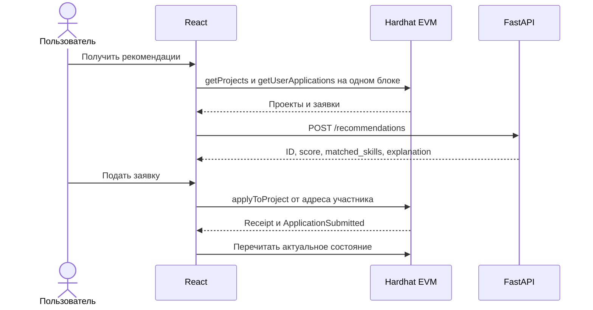

# Архитектура ProjectMatch

## Источники данных

Hardhat хранит проекты и заявки. Профиль хранится в `localStorage` по адресу, черновик проекта — в состоянии формы. FastAPI собирает модель на каждый запрос и использует снимок кандидатов, профиль и исключения из тела запроса. Смарт-контракт API самостоятельно не читает. Отправку транзакции инициирует явное действие пользователя.

## Контракт

- ID проекта начинается с 1, растёт монотонно. Ключ заявки — `(projectId, applicant)`. Индексы `projectApplicants` и `userProjectIds` позволяют обходить заявки с обеих сторон.
- Максимум 120, 1200 и 320 байт UTF-8 для названия, описания и списка навыков. Размер команды — 1–30, автор в лимит не входит.
- `getProjects(offset, limit)`, `getProjectApplications(id, offset, limit)` и `getUserApplications(address, offset, limit)` читают до 30 записей за вызов. Вне диапазона возвращается пустая страница. Запрос к отсутствующему ID в адресных методах возвращает пользовательскую ошибку контракта.
- Граф состояний заявки — переход из Pending в Accepted или Rejected. Закрытие проекта запрещает оба перехода и создание новых заявок. Число принятых увеличивается только при переходе в Accepted.
- Индексируемые поля событий содержат ID проекта и адреса участников операции. Журнал собирается начиная с блока деплоя. История принадлежит конкретной локальной цепочке и может исчезнуть при её сбросе.
- Состояние и параметры транзакций публичны для узла. Даже закрытый проект остаётся доступен для чтения. Для учебного запуска используйте публичные описания без ФИО, контактов, ключей или иных приватных сведений.

## API

- `GET /health` отвечает `{"status":"ok"}`.
- `POST /recommendations` принимает `user_address`, `applied_project_ids`, `projects`, `profile` и `top_k` от 1 до 20. Пользовательские данные проходят Pydantic-валидацию. При ошибке формата ответ 422 перечисляет поля с ошибками, при сбое расчёта ответ 500 содержит понятное сообщение.
- Один запрос принимает до 1000 кандидатов и до 1000 ID заявок. При повторном ID используется первая переданная запись. Проекты со статусом closed, своим адресом, заполнением и ранее поданной заявкой исключаются перед векторизацией.
- Пустой результат — `{"recommendations":[]}` со статусом 200. Объяснение содержит совпавшие нормализованные навыки или общие слова. Score от 0 до 1 характеризует текстовую близость.
- CORS допускает заданные loopback-origin фронтенда. Сервер слушает только `127.0.0.1`. CORS описывает доступ из браузеров. Контроль полномочий для транзакций выполняет контракт.

Поля и примеры вызова доступны на [локальной странице OpenAPI](http://127.0.0.1:8000/docs). Скрипт [smoke.js](../blockchain/scripts/smoke.js) делает реальные запросы после чтения контракта. [Результаты оценки](evaluation.json)
