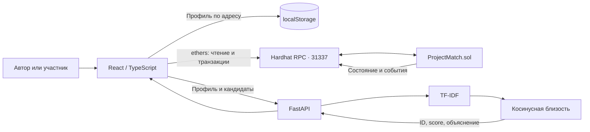

# ProjectMatch

**Тема** — разработка децентрализованной платформы поиска участников студенческих проектов с применением рекомендательной системы.

## 1. Инновационно-экономическая часть

### Проблема и аудитория

Студентам приходится искать команды в нескольких группах и переписках. Описания проектов быстро теряются среди новых сообщений, а состояние «есть ли место и рассмотрена ли моя заявка» приходится уточнять вручную. Руководителям проектов важно видеть заявки в одном месте и сопоставлять потребности команды с интересами участников. Университету может быть полезна общая витрина проектов по нескольким лабораториям или дисциплинам.

Студент получает каталог с фильтром, подбор по профилю и видимый статус заявки. Автор публикует требования, задаёт число мест и ведёт набор. Участие мотивируется доступом к учебным проектам, опытом совместной работы и возможностью собрать портфолио.

### Существующие подходы

- **Чат группы** удобен для быстрого контакта и обсуждений. Статус набора и критерии отбора команда обычно описывает сообщениями. В ProjectMatch они представлены отдельными полями и событиями.
- **GitHub** помогает хранить код и вести журнал задач проекта. GitHub Issues поддерживает обсуждение идей, ошибок и задач. Каталог ProjectMatch охватывает набор до начала совместной работы над кодом. [GitHub Docs](https://docs.github.com/en/issues/tracking-your-work-with-issues/learning-about-issues/about-issues)
- **Devpost** позволяет найти участников конкретного хакатона и отправить запрос на команду со страницы Participants. ProjectMatch ориентирован на каталог учебных инициатив и заявку на конкретный проект с проверяемой историей решения. [Devpost Help Center](https://help.devpost.com/article/75-participants-page-forming-a-team)

### Экономика и проверка ценности

Гипотеза B2B — вуз оплачивает развёртывание, подключение существующей учётной системы и сопровождение каталога. Студенты пользуются сервисом без платы. Основные издержки — инфраструктура, поддержка, интеграция, модерация, оценка качества рекомендаций и аудит контракта. На пилоте можно измерить время до первого отклика, долю проектов с набранными командами, долю рассмотренных заявок и долю релевантных результатов по отзывам студентов. Тарифы и прогнозы выручки требуют результатов пилота.

ProjectMatch обходится без отдельного токена, эмиссии, сжигания и расчётов между пользователями. Это снижает сложность сценария, исключает спекулятивную мотивацию и избавляет от необходимости управлять ценой или резервом. Тестовый ETH в Hardhat служит для газа. StudyToken из лабораторной работы развёртывается отдельно.

### Что даёт блокчейн

Запись заявки и решение связываются с адресом отправителя, блоком, хешем и событием. Сторона, имеющая доступ к цепочке, может сверить событие и текущее состояние с правилами контракта. Контракт сам проверяет владельца, статус и число свободных мест. Профиль и подбор остаются вне цепочки.

Вариант с обычной БД упростил бы исправление и удаление данных, модерацию, запросы и вход по учётной записи вуза. Проверяемость решений в этом варианте зависела бы от оператора и журнала аудита. В EVM чтение через RPC и подписи добавляют задержки и сложность, хранение текста увеличивает газ. Локальный Hardhat имитирует этот сценарий на одном узле. Оператор локального узла может сбросить или остановить сеть, поэтому демонстрация не моделирует устойчивость публичной сети к действиям оператора.

### Риски и ограничения MVP

Адрес удостоверяет управление кошельком, а университетская личность потребовала бы отдельной интеграции. Открытые данные цепочки могут сохраняться в копиях и журналах даже после закрытия проекта. Для демонстрации используются вымышленные учебные описания и тестовые адреса. Удаление, модерация, управление репутацией и защита от спама входят в задачи следующего этапа. TF-IDF зависит от совпадения слов и качества описаний, а оценки на синтетике имеют узкую область применимости.

## 2. Архитектура и функционал

Пользователь подключает кошелёк, создаёт проект или откликается. Автор принимает, отклоняет или закрывает набор. Карточка каталога выводит навыки, число принятых участников, статус и адрес автора. «Мои проекты» и «Мои заявки» отражают разные стороны одной записи. «Транзакции» показывает события текущего контракта. После операции интерфейс выводит фактический receipt с хешем, номером блока, статусом и именами событий.

- `Project` содержит ID, адрес автора, название, описание, навыки, лимит мест, счётчик принятых, флаг активности и время.
- `Application` идентифицируется парой проект и адрес участника. В ней хранятся ID проекта, адрес, статус и время.
- Профиль — навыки, интересы и краткое описание. Браузер хранит его локально по адресу. При явном запросе рекомендаций он передаётся в FastAPI.
- Пагинация контрактных списков ограничивает страницу 30 записями. Фронтенд загружает страницы каталога, заявок и журнал для текущего развёртывания.
- Локальный `JsonRpcProvider` использует аккаунты № 0 и № 1 в режиме демо. MetaMask подписывает сам за выбранный аккаунт. Перед записью проверяется сеть 31337 и соответствие развёртывания.

Закрытие окончательное. Контракт блокирует новые заявки и решения по ожидающим. Статус Pending остаётся в цепочке, UI отображает «Без решения · проект закрыт». Pending не резервирует место. При заполненном активном проекте нельзя принимать новые заявки, но отклонять ранее поданные заявки можно. [Детали схемы и API](ARCHITECTURE.md)

### Рекомендательная система

1. Фронтенд читает снимок каталога и заявок из контракта. Из кандидатов исключаются свои, закрытые, заполненные и уже заявленные проекты. API повторяет фильтрацию по переданным данным и убирает повторные ID.
2. Препроцессинг приводит кириллицу и латиницу к общему регистру, нормализует Unicode и алиасы, убирает частые служебные слова. Например, `TS` и `TypeScript` получают одинаковое представление. Навыки добавляются в текст дважды, чтобы увеличить их вклад.
3. `TfidfVectorizer` строит признаки слов и соседних пар слов по корпусу доступных проектов. Профиль переводится в тот же словарь. Вес терма $t$ в документе $d$ до L2-нормировки по умолчанию равен $tf(t,d) \cdot idf(t)$, где $idf(t) = 1 + \ln((1 + N)/(1 + df(t)))$. Здесь $N$ — число кандидатов, $df(t)$ — число документов с термом. Вес растёт, когда признак частый в документе и редкий в каталоге. [Документация TfidfVectorizer](https://scikit-learn.org/stable/modules/generated/sklearn.feature_extraction.text.TfidfVectorizer.html)
4. Косинусная близость $s(q,d) = (q \cdot d)/(\lVert q\rVert_2 \lVert d\rVert_2)$ измеряет сходство направлений векторов профиля и проекта. Выше располагаются проекты, где больше важных общих признаков. Возвращаются положительные оценки и пояснения по пересечению навыков или общим словам. При равенстве с точностью до 12 знаков выше ставится меньший ID. [Документация cosine_similarity](https://scikit-learn.org/stable/modules/generated/sklearn.metrics.pairwise.cosine_similarity.html)

Это контентная модель информационного поиска. Она локально рассчитывает численные признаки и использует детерминированные пояснения. При пустом профиле, пустом словаре или отсутствии совпадений отдаётся пустой список.

### Фактическая оценка

12 проектов из seed и 10 вручную размеченных синтетических профилей. Для каждого профиля была заранее задана релевантность по ID. Precision@K — доля релевантных среди K мест, Recall@K — доля найденных от всех релевантных, NDCG@K учитывает позицию с логарифмическим дисконтом. Пустые позиции считаются нерелевантными. Макросреднее даёт одинаковый вес каждому профилю. Baseline использует одну случайную перестановку на профиль с фиксированным seed 42.

- **K = 3.** TF-IDF показал Precision **0.633333**, Recall **0.908333**, NDCG **0.945044**. Случайный baseline — **0.066667**, **0.075000**, **0.084779** соответственно.
- **K = 5.** TF-IDF показал Precision **0.420000**, Recall **0.966667**, NDCG **0.965255**. Случайный baseline — **0.100000**, **0.233333**, **0.156542** соответственно.

У ряда профилей меньше пяти релевантных проектов, что ограничивает достижимую Precision@5. Профили и проекты составлены для демонстрации, поэтому результат характеризует только этот набор и не доказывает эффективность на реальных студентах. [Сохранённый результат запуска оценки](evaluation.json)

### Roadmap

- **Реализовано сейчас.** Локальный реестр и проверки статусов, адаптивный интерфейс, профиль, подбор, повторяемая оценка, скрипты и автоматические тесты.
- **В будущем.** Аудит и нагрузочная проверка, публичная тестовая сеть, интеграция с учётной системой вуза, согласие и правила обработки данных, модерация, оценка на реальных анонимизированных данных, проверка улучшений нормализации и ранжирования.

## 3. Реализация и результаты

- [ProjectMatch.sol](../blockchain/contracts/ProjectMatch.sol) — `createProject`, `applyToProject`, `acceptApplication`, `rejectApplication`, `closeProject` и чтение состояния.
- [Скрипты сети](../blockchain/scripts/) — развёртывание, seed, демо, smoke и перевод StudyToken.
- [Признаки](../backend/app/features.py), [ранжирование](../backend/app/ranking.py), [API](../backend/app/main.py) и [оценка](../backend/evaluate.py).
- [React](../frontend/src/App.tsx), [ethers и receipt](../frontend/src/chain.ts) и [запрос подбора](../frontend/src/recommendations.ts).
- [Установка и запуск](../../README.md), [сценарий защиты](DEFENSE.md) и [снимки](SCREENSHOTS.md).

На Windows (сборка 26200) проверены компиляция обоих контрактов Solidity 0.8.24, 18 тестов Hardhat, 13 тестов pytest, проверка согласованности пакетов Python и сборка TypeScript/Vite. Два теста Playwright в Edge проверили сквозной сценарий «автор → участник → автор» и мобильные фильтры. Seed на чистой ноде создал 12 проектов. Повторный seed оставил число проектов равным 12. Smoke-тест прочитал реестр, получил ответ /health и персональные оценки /recommendations, создал заявку и подтвердил заполнение места после решения. В проверенном прогоне профиль Python/ML вывел первым проект № 14 с score 0.636937, профиль Figma/UX — проект № 8 с score 0.475367.

### Пример фактических транзакций CLI

Сеть Hardhat 31337, контракт `0x5FbDB2315678afecb367f032d93F642f64180aa3`, проект № 13. Все три receipts вернули статус 1.

- Блок 14, `ProjectCreated` — `0x01133bf7b6b04bc4de06cda0c054ad806e5d5f3890dc7086b2b4b6718920195d`.
- Блок 15, `ApplicationSubmitted` — `0x928a7d18c2671e5c82ed8728a9f966af85323af7bcb19c47e11c83cf5e7658d1`.
- Блок 16, `ApplicationStatusChanged` — `0x2aefb591474aa24debb5fee3f756981e8c4711037028e9c942c682260b99b7d4`.

Итог в контракте — одна принятая заявка из двух возможных мест, статус Accepted. Хеши относятся к конкретному локальному прогону. Новый запуск записывает свои фактические receipts.

Ссылка получена из `git remote -v`. Изменения находятся в рабочем дереве. [Репозиторий origin](https://github.com/Mun-Robbery/blockchain-edu)
